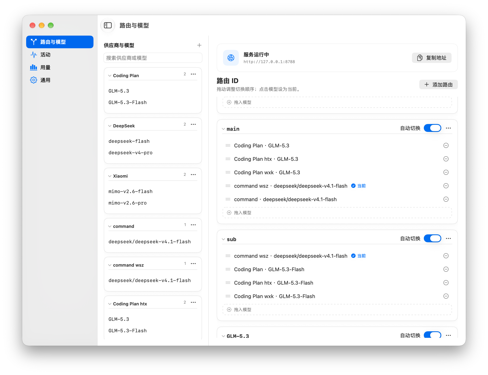
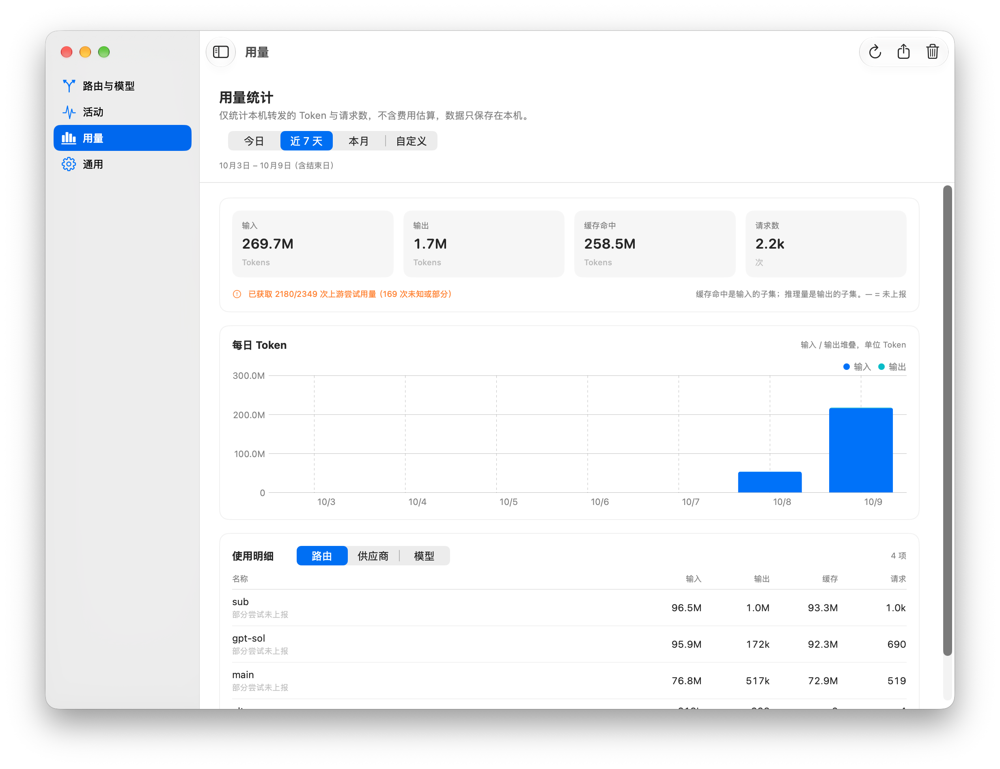

# EZ Switch

**轻量级 macOS 原生大模型反向代理工具。** 在本机提供 OpenAI / Anthropic 兼容接口，让 Codex、Claude Code、OpenCode 等工具始终请求固定的本机模型 ID，真实上游供应商与模型在 EZ Switch 中随时切换。

## 为什么用 EZ Switch

- **热切换模型**：工具侧只认本机模型 ID，在 GUI 或菜单栏切换真实上游模型立即生效，不需要改 harness 配置或重启客户端。
- **自动回退**：开启后，套餐限额或限流返回 HTTP 429、上游临时故障（500/502/503/504）或连接失败时，按候选顺序自动切换上游模型。可在“通用”页开启“自动切换通知”（默认关闭），每次开始回退到下一个候选时发送系统通知。
- **集中管理供应商**：API Key、Base URL、请求头和模型列表统一放在 EZ Switch，不需要在每个工具里重复配置。
- **本地原生应用**：macOS 原生 GUI，服务只监听 `127.0.0.1`，请求直接转发到配置的上游。

## 界面预览





## 安装

从 [GitHub Releases](https://github.com/LuohaoSun/ez-switch/releases) 下载最新 `EZSwitch-*.dmg`，打开后将 `EZSwitch.app` 拖入 `Applications`。要求 macOS 13 或以上，Release 为 Apple Silicon（arm64）版本。注意：**出站代理**的 `https://` 代理需要 macOS 14 或以上（`http` / `socks5` 自 macOS 13 起可用）。

> 当前 DMG 使用 ad-hoc 签名，未经过 Apple Developer ID 公证。首次启动如被 macOS 阻止，请前往 `系统设置 → 隐私与安全性`，在安全提示中点击 **“仍要打开”**，然后再次确认打开应用。

## 快速开始

首次启动会打开设置窗口，并预置一个 `DeepSeek官方 · deepseek-flash` 供应商示例，`main` 默认指向它。已有配置不会被更新为新示例。侧栏可切换“供应商与路由”“扩展”“用量”“性能”“活动”“通用”。

本地服务默认地址：

```text
http://127.0.0.1:8788
```

### 1. 配置供应商

在“供应商与路由”页左侧添加供应商，填写连接信息：

- 供应商名称
- Chat Completions、Responses、Messages、Gemini 原生四类接口是否启用
- 每类接口对应的完整 Base URL
- API Key 和可选额外请求头

点击“获取模型列表”请求供应商接口，用原生复选框选择模型后保存；已添加的模型默认勾选，取消勾选后保存会移除该模型及其路由引用，取消窗口则保留原配置。也可以直接点“保存”暂不获取模型，先把连接配置落地（用于先到“扩展 → 出站代理”勾选该供应商并配置代理，再回来获取模型列表），首条模型添加后占位记录自动移除。列表接口未返回的现有模型保持不变。同一供应商下的所有模型共用这套连接配置，不支持列表接口的供应商仍可手动添加模型。供应商卡片中的模型可单击选中，按回车原地重命名，回车保存、Esc 取消，也可右键选择“重命名”或“删除”；重命名修改的是请求上游时使用的模型 ID。

### 2. 配置路由与自动回退

路由页预置固定的本机模型 ID `main`。把左侧模型拖到右侧路由的任意插入位置即可添加候选，在右侧上下拖动调整自动切换顺序，点击某个模型将它设为当前模型；每条路由可单独开关“自动切换”。Codex 和 Claude Code 会自动选一个兼容 ID 作为默认模型，其余兼容 ID 可在工具中显式指定；OpenCode 的提示词包含全部本机模型 ID。

自动切换产生的多次上游尝试归属于同一个请求；已开始输出的流无法中途切换。「活动」页记录切换时的路由、失败模型、尝试序号、HTTP 状态或连接错误与下一个模型，并遮蔽该供应商的凭据。

自动回退的请求成功完成后，后续请求继续使用该上游，冷却结束也不会自动切回；再次遇到可回退错误时继续尝试其他候选。手动选择立即生效。自动回退结果仅在本次运行期间保留，重启后使用已保存的选择。

### 3. 接入工具

在“通用”页的“接入工具”中选择：

- **Codex** / **Claude Code**：点击“一键配置”接入本机端点，无需逐个选模型；应用会在确认后备份用户级配置，可“一键恢复”。重新启动对应工具后生效。
- **OpenCode**：页面展示包含端点与全部本机模型 ID 的提示词，可通过“复制提示词”交给 agent；不提供一键配置。

其他 OpenAI-compatible 工具填写 `base_url = http://127.0.0.1:8788/v1`、`api_key = any-local-placeholder`、`model = main` 即可。这里的 key 只用于满足工具的启动检查，真实上游 API Key 保存在 EZ Switch 中。

### 4. 用量、活动与隐私

侧栏“用量”按今天、近 7 天、近 30 天或自定义区间查看输入／输出与缓存命中，提供趋势图（今天按小时、其余按天）、按路由／供应商／模型分组及 CSV 导出；点击柱状图可查看该时段的精确输入／输出／合计，再次点击取消。“性能”是独立入口，复用同一组区间查看请求数（按请求去重，自动回退只计一次）、请求数柱状图（今天按小时、其余按天）与流式请求的首输出延迟（TTFT）、吞吐（TPS）；点击请求数柱会把指标卡与性能明细收敛到该时段，再次点击取消。“性能明细”表点击列头排序、再次点击反向，未测样本恒定置后；有效样本数在数值悬停提示与顶部卡片中展示。

侧栏“活动”是运行期内的实时视图：顶部是“请求 → EZSwitch → 上游”流向图，下方是请求与尝试表。进行中的请求与最近 300 条已完成请求分开保存（在途不受上限淘汰），已完成节点自结束起在图上驻留 5 秒；每次模型回退都会新增一条尝试记录，旧记录标记「已回退」并保留失败模型与原因，新记录显示新的模型和状态；展开可查看该次尝试的缓存、推理、首字与失败原因。点击图上节点仅高亮，不改变列表内容。活动数据只存在于本次运行的进程内，不含请求／响应正文、密钥或 Base URL，退出即清空。详见[活动说明](Docs/activity.md)。

统计仅覆盖经过本机代理的请求，从启用后开始，不代表供应商账单，也不估算费用；缺失的 usage 标记为未知，不记成零。数据保存在配置目录的本地 `usage.sqlite`（使用 macOS 系统 SQLite），不存提示词、回答正文或密钥，数据库异常不影响转发。详见[用量统计说明](Docs/token-usage.md)。

## 支持的接口

| 本机接口 | 用途 | 上游路径 |
| --- | --- | --- |
| `/v1/chat/completions` | OpenAI Chat Completions | Base URL + `/chat/completions` |
| `/v1/responses` | OpenAI Responses / Codex | Base URL + `/responses` |
| `/v1/messages` | Anthropic Messages / Claude Code | Base URL + `/v1/messages` |
| `POST /v1beta/models/{model}:generateContent` | Gemini 原生生成 | Base URL + `/models/{model}:generateContent` |
| `POST /v1beta/models/{model}:streamGenerateContent?alt=sse` | Gemini 原生流式生成 | Base URL + `/models/{model}:streamGenerateContent?alt=sse` |
| `POST /v1beta/models/{model}:countTokens` | Gemini Token 计数 | Base URL + `/models/{model}:countTokens` |
| `GET /v1beta/models`、`GET /v1beta/models/{model}` | Gemini 格式的本地路由目录 | 本地返回，仅展示支持 Gemini 的路由 |

默认按原协议转发，不做协议翻译；上游不支持某类接口时会原样返回上游错误。

原生 Responses 的流式响应会做轻量事件重排：当前输出项的事件一律即时转发，仅当上游把后一项交错在前一项收尾之前时才暂存并顺延，避免客户端因活跃项错位而丢字；事件本就规范时保留其顺序与流式放行时机，事件序号按下发顺序统一重编号。重排只作用于 `/v1/responses` 的 SSE 响应。

原生 Gemini 的模型 ID 写在请求路径里：本机请求 `POST http://127.0.0.1:8788/v1beta/models/main:generateContent` 会按路径中的 `main` 选路，再替换为远端模型 ID。Gemini 的原生 Base URL 填完整版本前缀（预设为 `https://generativelanguage.googleapis.com/v1beta`），路由器追加 `/models/{model}:{操作}`。正文保持 Gemini 原生格式，上游认证使用配置中的 `x-goog-api-key`，客户端查询参数里的 `key` 不会转发。流式请求保留客户端选择的 SSE 或 JSON 数组格式；JSON 数组可提取最终用量，但不提供流式 TTFT/TPS。`countTokens` 的预估结果不计实际消耗、不改变生成请求的运行时首选。暂不提供 Vertex AI OAuth、文件／缓存资源管理、Live API 或 Gemini 跨协议翻译。

若上游只提供 Chat Completions，可在侧栏“扩展”页开启内置的 **Chat → Responses** 转换，并按供应商勾选（顶部的扩展总开关 + 供应商名单；按供应商生效，不对单个模型单独设置）。开启且勾选后，Codex 仍请求本机 `/v1/responses`，应用用内置转换器生成 Chat 请求并把响应转回 Responses：转换复用该供应商已配置的 Chat Completions 地址与凭据，不改写原生地址、凭据或协议开关；未开启或未勾选的供应商保持原生 Responses 转发。该模式要求客户端发送完整历史，明确拒绝 `previous_response_id`、`conversation` 和远程压缩，转换并非无损。详见[扩展说明](Docs/extensions.md)。

「扩展」页还提供 **出站代理**：一条地址（支持 `http` / `https` / `socks5`，须带端口，首版无认证、无 PAC），以及两份勾选名单——**原生供应商**（按名）与**已注册连接器**（按来源）。总开关关闭或来源未勾选即**严格直连**（不隐式使用系统或环境代理）；代理失败只让当前候选失败并走现有自动回退，**不偷偷直连**。该策略对推理、模型目录与 Chat → Responses 一致；连接器自带的上游出站（含 OAuth 与令牌刷新，若有）同样按其出站。连接器自带的本地通道恒为直连；但被勾选走代理的原生供应商若上游本身是本机回环（`127.0.0.1`），CFNetwork 对回环目标在 `https`/`socks5` 代理下会绕过代理，此时明确报错并要求取消勾选，不静默直连。修改代理会重启受影响的连接器组件、可能中断进行中的工具会话；`https://` 代理需 macOS 14+。目前没有内置连接器，名单里实际列出的只有原生供应商；连接器来源选择能力保留给将来注册的扩展。详见[扩展说明](Docs/extensions.md)。

## 命令行入口 ezs

应用包内含命令行工具 `Contents/MacOS/ezs`。把 `EZSwitch.app` 安装到 `Applications` 后，在“通用”页点击“安装命令行工具”，应用会在 `/usr/local/bin/ezs` 创建指向应用内命令的符号链接（必要时由系统请求管理员授权）。CLI 经用户私有目录中的 Unix socket 与应用通信，不直接修改配置文件；应用未运行时命令报错。

```bash
ezs --help
ezs list
ezs set main --provider "command-wsz" --model "deepseek/deepseek-v4.1-flash"

# 查看用量：默认今天、按路由分组、最多 100 组
ezs usage
ezs usage --period 7d --group provider
ezs usage --from 2026-01-01 --to 2026-01-31 --limit 1000
ezs usage --json
# 追加流式性能：平均 TTFT 与加权 TPS，默认按模型分组
ezs usage --performance
```

`list` 显示各本机模型 ID 的绑定及各供应商下的可选模型；`set` 让运行中的应用立即切换并保存。`usage` 与应用内“用量”页同一数据源，支持 `today|7d|month` 预设或 `--from`／`--to` 自定义区间、`route|provider|model` 分组与 `--json` 输出；覆盖率不足时明确标注为“已上报部分”，不做估算。`--performance` 复用同一区间/分组/`--limit`，在用量之外附加流式 TTFT 与含 TTFT 的 TPS 统计（`route` 分组展示含切换的 requestTTFT，其余展示上游 attemptTTFT；无样本显示 `—`、JSON 为 `null`）。不带 `--performance` 的旧调用与应用端行为完全不变；旧版应用不支持该字段时会提示更新并重启。详见[用量统计说明](Docs/token-usage.md)。

> `usage` 命令从 0.3.2 起提供，`--performance` 从 0.3.5 起提供；应用和 CLI 都需更新到对应版本或以上。

## 配置与限制

配置文件位于 `~/Library/Application Support/EZSwitch/config.json`。

- 服务只监听本机，不提供远程访问和鉴权。
- 修改端口后需要重启应用。
- 每条路由有独立的有序候选列表，按可回退的上游失败顺序尝试；不做负载均衡。
- 默认按原协议转发；**Chat → Responses** 转换在“扩展”页开启总开关并按供应商勾选，按供应商生效，不对单个模型单独设置。
- 扩展随应用内置：**Chat → Responses** 由独立 helper 进程按请求执行；**出站代理**由通用 `OutboundPolicy` 接口与 `Extensions/Proxy` 面板实现，不常驻运行。两者都不支持外部动态安装、热加载或第三方插件。出站代理是可选、低耦合的扩展，主干仅由组合点 `BuiltinExtensions.swift` 指名，可用 `EZSWITCH_DISABLE_PROXY=1` 在构建时整体排除。连接器框架（`ExtensionRegistry` / `ExtensionRuntime`）仍在主干保留，但当前没有内置连接器。这不是独立模块或二进制隔离，详见[扩展架构与移除说明](Docs/extension-architecture.md)。
- 出站代理：`http` / `socks5` 代理自 macOS 13 起可用，`https://`（TLS 到代理）需 **macOS 14 或以上**，低系统上明确报错、不降级直连。来源未勾选或总开关关闭即严格直连（不使用系统/环境代理）；代理失败只让当前候选失败并走现有自动回退，不偷偷直连。连接器本地通道恒直连；被勾选走代理的原生供应商若上游本身是 `127.0.0.1`，在 `https`/`socks5` 下会明确报错并要求取消勾选。修改代理会重启受影响的连接器组件，可能中断进行中的工具会话。
- 客户端请求头按端到端语义透传（含会话头、SDK 头与自定义头）；hop-by-hop 字段（含 `Connection` 声明的字段）、`Host`、`Content-Length`、`Accept-Encoding` 由本机或 URLSession 重新生成，供应商鉴权头按端点替换为配置的 API Key。供应商 `extraHeaders` 最后应用，可覆盖以上任何值。

## 许可证

[MIT License](LICENSE)。Responses → Chat 转换使用 CLIProxyAPI；该组件及其它第三方依赖的来源、版本与许可声明见 [ThirdParty/README.md](ThirdParty/README.md)。
